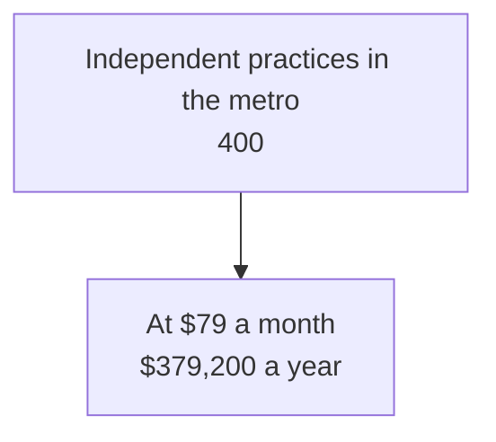

# Business Plan Document Schema

The artifact every skill of this plugin reads and writes. One file, `.agents_workspace/product/business/BUSINESS_PLAN.md`,
local and not committed, because a business plan holds pricing, unit economics, and kill criteria
that do not belong in a repo others can read. A plan at the old path, `product/BUSINESS_PLAN.md`,
moves to the new one, and the user is told it left the committed repo. It
is a **living document**: each interview loop revises it in place, not a fresh copy. When it
derives from app plans, it carries a `derived_from` field naming the plan stems it was built on.

`find-product-market-fit` creates the file and owns all 13 sections. The specialist skills each
deepen named sections with one subsection, listed under [Specialist subsections](#specialist-subsections).

## Template

A new plan is a copy of `../assets/business-plan.template.md`, relative to this file: its
frontmatter, the contents list, and the 13 section headings. The `schema: business-plan/v2` line
stays as written. Two older forms move up on the next revision:

- A plan carrying `artifact: BUSINESS_PLAN` predates the template: replace that line with the
  schema line, then apply the v1 step below.
- A `business-plan/v1` plan has no contents list and no numbers below h2: add both, per
  [Numbering and contents](#numbering-and-contents), and set the schema line to `v2`.

**Frontmatter:**

- `status`: `draft`, or `validated` once the PMF Readiness Gate passes and the user confirms it.
- `created`, `updated`: the date the plan was first saved and last revised.
- `product`: the product name, one line.
- `stage`: `idea`, `prototype`, `launched`, or `revenue`.
- `derived_from`: the build plans this was built on, for example `[product/plans/mvp.md]`, or
  `[]` when none. It names `ceh-build-planning` plans by their repo-relative path. Built plans are
  kept, so the path stays valid.
- `pmf_gate`: criteria met out of 8, per the PMF Readiness Gate below.

Specialist subsections go under their section, after its content.

## Sections

Every section carries a **confidence tag** on its riskiest claims: `[evidence]` (backed by a real
data point, quote, or transaction), `[assumption]` (believed but untested — the interview's
hunting ground), or `[hypothesis-to-test]` (an assumption with a named, cheap test attached).
A plan full of `[assumption]` tags has not found product-market fit yet — it has a to-do list.

Each section is a level-2 heading in the literal form `## §NN Title`, for example
`## §09 Go-to-Market`, so a skill can check a section exists by searching for `^## §09`. See the
[Worked example](#worked-example).

## Numbering and contents

- **Every heading below h2 carries a nested two-digit number** after its parent's:
  `### §04.01 Strategy`, `#### §12.01.01 Commitments`, down to h6. Numbers follow position in the
  section, so a subsection added above another shifts its number. A skill finds a subsection by
  its title, the text after the number, never by the number.
- **A linked contents list sits just before `## §01`**, under a line that reads `**Contents**`,
  one bullet per heading from h2 to h6, each level indented two more spaces, linked by GitHub's
  anchor for the heading (`[§04.01 Strategy](#0401-strategy)`). The HTML build drops it from that
  line to the first `## ` heading, because the page draws its own contents rail.
- **`develop-business-plan` owns both.** After every specialist returns, it renumbers the headings
  below h2 and rewrites the contents list from the headings. That pass is the one edit the router
  makes, so no specialist renumbers another's subsection. A skill that writes the plan with no
  router around it, such as `find-product-market-fit` drafting v0, numbers its own headings and
  writes the list itself.

## Diagrams

The plan is drawn as well as written, for a reader who scans before reading. Where the text
describes a flow, a funnel, a split, a position, or a timeline, a Mermaid diagram sits beside the
paragraph it shows.

- **A diagram is a reading aid, never a replacement.** Every sentence stays, and a diagram makes
  no claim the text does not. A diagram or table that summarises the plan uses only facts in it,
  and says "not stated" where the plan is silent.
- **A diagram belongs to the skill that owns the text beside it**, and that skill updates it in the
  same edit that changes the text. The milestone timeline sits in §13 under
  `find-product-market-fit`, and draws the kill dates `run-premortem` tagged there as they stand.
- **The default set**, drawn when the text supports it, never invented to fill a slot:

| Where           | Diagram                                                 | Mermaid type     |
| --------------- | ------------------------------------------------------- | ---------------- |
| §01 or preamble | The payoff chain: what the product leads to, in order   | `flowchart LR`   |
| §05             | Scope (what it does and does not do), and the core loop | `flowchart`      |
| §06             | Positioning against the named alternatives              | `quadrantChart`  |
| §06             | Capabilities side by side, "not stated" where silent    | a Markdown table |
| §05 or §13      | Build stages                                            | `flowchart LR`   |
| §07             | The market funnel, TAM to SOM                           | `flowchart TB`   |
| §09             | The channel funnel to the first ten customers           | `flowchart LR`   |
| §11             | Where the hours or the money go                         | `xychart-beta`   |
| §13             | Milestones on a timeline, kill criteria marked `crit`   | `gantt`          |

A diagram can render without an error and still be unreadable:

- Chain subgraphs with invisible links (`A ~~~ B`) and give each `direction LR`, or Mermaid lays
  them out in an arbitrary order.
- In a `gantt` chart with `axisFormat %b %Y`, set `tickInterval 2month` or wider, or the axis
  labels overlap.
- Set a horizontal `xychart-beta`'s height under `config.xyChart.height` in the diagram's front
  matter, or a chart with few bars renders far too tall.
- Validate every diagram with the Mermaid CLI,
  `npx -p @mermaid-js/mermaid-cli mmdc -i <file>.md -o <out>.md`, then look at the rendered
  result, because overflowing labels and a diagram scaled down to unreadable text both pass the
  CLI.

## HTML version

`BUSINESS_PLAN.html` sits next to the plan: one self-contained page in the Meridian theme, a
reading column with a contents rail from h2 to h6, evidence tags as coloured labels, and every
diagram rendered. It is generated, never edited: the markdown stays the source, and both are
kept. `develop-business-plan` rebuilds it after every specialist with
`node ${CLAUDE_PLUGIN_ROOT}/scripts/build-plan-html.cjs <plan.md>`, which reads its page shell and
`brand.css` from the plugin's `assets/`. The page loads Mermaid from a CDN, so offline each diagram
shows its source text instead.

| ID  | Title                      | Content                                                                                                                                                                                        |
| --- | -------------------------- | ---------------------------------------------------------------------------------------------------------------------------------------------------------------------------------------------- |
| §01 | Executive Summary          | Three sentences: what it is, who it's for, why now. Written **last**, regenerated each loop.                                                                                                   |
| §02 | Problem                    | The specific job-to-be-done. Who has it, how often, how painful, what it costs them today. The problem severity is the load-bearing claim — tag it honestly.                                   |
| §03 | Target Customer            | The beachhead segment, not "everyone." Named persona or firmographic. Reachability: where they already are. Why this segment first.                                                            |
| §04 | Value Proposition          | The one-line promise, the before/after, and the single most important differentiator. The "why you, why not the alternative" sentence.                                                         |
| §05 | Solution / Product         | What it does at the level a customer cares about — outcomes, not features. Link to the app plan (`derived_from`) for the technical detail; do not restate architecture here.                   |
| §06 | Alternatives & Competition | What the customer uses today (including spreadsheets, doing nothing, a manual workaround — the real competition is usually inertia). Named competitors, and the wedge that beats each.         |
| §07 | Market                     | TAM / SAM / SOM with the **arithmetic shown** (bottom-up: customers × price, not a top-down analyst number). The SOM 12-month target and the assumption behind it.                             |
| §08 | Business Model & Pricing   | How money is made, who pays, the price point and its basis (value-based, cost-plus, competitor-anchored). Unit economics: rough CAC, LTV, gross margin, payback.                               |
| §09 | Go-to-Market               | The first acquisition channel and why it fits where the customer already is. The motion (self-serve, sales-led, community, content). First 10 customers plan.                                  |
| §10 | Traction & Validation      | Evidence to date: signups, LOIs, pre-orders, interviews, waitlist, prototype usage. Empty is allowed and honest at idea stage — but then §10 names the **next validation experiment** instead. |
| §11 | Financials                 | A lightweight model: revenue drivers, key costs, runway, the break-even or next-raise milestone. Not a 5-year spreadsheet — the three numbers that decide viability.                           |
| §12 | Risks & Unknowns           | The assumptions that, if wrong, kill the business — ranked. Each paired with the cheapest test that would de-risk it. This section feeds the next interview loop.                              |
| §13 | Milestones                 | The next 3–4 dated, falsifiable milestones (each one validates or kills an assumption from §12).                                                                                               |

§05 deliberately defers product detail to the app plan when one exists — the business plan owns
the _why it sells_, the app plan owns the _how it is built_. Do not duplicate architecture, data
models, or API surface here.

## Specialist subsections

Each specialist skill owns one `###` subsection per section, under the literal title below with
its number in front (`### §12.01 Premortem`), and replaces it in place on a re-run. Its parts are `####` headings inside it. The section's original
content stays above it. Every claim keeps a confidence tag.

| Skill                        | Owns                                                 | Also writes                                                                                                                                |
| ---------------------------- | ---------------------------------------------------- | ------------------------------------------------------------------------------------------------------------------------------------------ |
| `sharpen-strategy`           | §04 `### Strategy`                                   | §06: one copy-cost line per named competitor. Gate criterion 3. Removes refused items from §05, §09, §13 only after the user confirms them |
| `stress-test-unit-economics` | §08 `### Unit model`, §11 `### Cash and sensitivity` | §12: one kill-input line. Gate criteria 5 and 6                                                                                            |
| `plan-go-to-market`          | §09 `### Go-to-market plan`                          | §10 and §13: one line each for the channel test. Gate criteria 2 and 7                                                                     |
| `run-premortem`              | §12 `### Premortem`                                  | §13: one line per scheduled test and kill date. Gate criterion 8                                                                           |
| `set-operating-plan`         | §13 `### Operating plan`                             | Nothing                                                                                                                                    |

`review-business-plan` reads every section and writes none.

Three rules keep the writers apart:

- A line a specialist writes outside its own subsection ends with the skill name in parentheses,
  for example `(run-premortem)`. A re-run replaces its own tagged lines and no others.
- No skill edits another skill's subsection or tagged lines. `find-product-market-fit` revises
  the section content above the subsections and leaves them as they are.
- A skill that re-scores a gate criterion updates `pmf_gate`. Whenever `pmf_gate` is below `8/8`,
  `status` is `draft`.

## PMF Readiness Gate

The loop exit condition. The plan is **satisfiable** (`status: validated`) only when all eight
criteria below are met **and** the user explicitly confirms they are satisfied. Each loop, score
the gate honestly in frontmatter (`pmf_gate: N/8`) and report which criteria remain open.

A criterion is "met" when its claim is either backed by `[evidence]` **or** reduced to a named
`[hypothesis-to-test]` with a concrete, cheap, time-boxed experiment — not left as a bare
`[assumption]`. Honest "we will test this next" passes; hand-waving does not.

1. **Problem is real and acute** — §02 names a specific customer who feels this often enough and
   painfully enough to act. Not "would be nice." Severity is evidenced or has a test.
2. **Beachhead is narrow and reachable** — §03 is one nameable segment you can actually reach,
   not "SMBs" or "everyone." You can describe where the first 10 customers physically are.
3. **Differentiation is defensible** — §04/§06 state why the customer picks you over the real
   alternative (including doing nothing), and why that advantage is not trivially copied.
4. **Willingness to pay is established** — §08 ties the price to a value the customer has signaled
   they will pay for (a quote, a comparable spend, a pre-order) — not a guessed number.
5. **Market math is bottom-up and non-trivial** — §07 SOM is built from customers × price with
   stated assumptions, and the result is large enough to matter.
6. **Unit economics can work** — §08 shows a plausible path to LTV > CAC with a sane payback,
   even if the inputs are still estimates.
7. **A credible first channel exists** — §09 names one channel matched to where the customer
   already is, with a first-10-customers plan, not a list of every channel.
8. **The riskiest assumption has a test** — §12 ranks the kill-risks and pairs the top one with
   the cheapest experiment that would settle it, scheduled in §13.

When fewer than 8 are met, the open criteria **are the agenda** for the next interview loop —
attack the lowest-scoring, highest-leverage one first.

## Worked example

An idea-stage plan after one loop and a premortem, cut to one line per section and one diagram.
The heading lines and frontmatter keys are literal.

````markdown
---
schema: business-plan/v2
status: draft
created: 2026-03-02
updated: 2026-03-09
product: Ledgerline
stage: idea
derived_from: [product/plans/mvp.md]
pmf_gate: 5/8
---

**Contents**

- [§01 Executive Summary](#01-executive-summary)
- [§02 Problem](#02-problem)
- [§03 Target Customer](#03-target-customer)
- [§04 Value Proposition](#04-value-proposition)
- [§05 Solution / Product](#05-solution--product)
- [§06 Alternatives & Competition](#06-alternatives--competition)
- [§07 Market](#07-market)
- [§08 Business Model & Pricing](#08-business-model--pricing)
- [§09 Go-to-Market](#09-go-to-market)
- [§10 Traction & Validation](#10-traction--validation)
- [§11 Financials](#11-financials)
- [§12 Risks & Unknowns](#12-risks--unknowns)
  - [§12.01 Premortem](#1201-premortem)
- [§13 Milestones](#13-milestones)

## §01 Executive Summary

Ledgerline reconciles supplier invoices for independent dental practices, because the practice
manager loses a day a month to it.

## §02 Problem

Practice managers match about 120 invoices a month by hand. "I lose the last Friday of every
month to this" (manager, 3-chair practice) [evidence]

## §03 Target Customer

Independent dental practices with 2 to 5 chairs in one metro area [assumption]

## §04 Value Proposition

The month-end match done in ten minutes instead of a day [hypothesis-to-test]

## §05 Solution / Product

Upload the statement, get the mismatches. Technical detail: see `product/plans/mvp.md`.

## §06 Alternatives & Competition

A spreadsheet and a highlighter. No named competitor serves practices this small [assumption]

## §07 Market

400 practices x $79 x 12 = $379,200 a year in the metro area [assumption]



## §08 Business Model & Pricing

$79 a month per practice, anchored to one day of a manager's pay [assumption]

## §09 Go-to-Market

The regional dental managers' association list, contacted by hand [hypothesis-to-test]

## §10 Traction & Validation

Three interviews, one quote. Next experiment: ten more calls from the association list.

## §11 Financials

Break-even at 60 practices, with 9 months of runway [assumption]

## §12 Risks & Unknowns

1. Managers will not pay from their own budget [hypothesis-to-test]

### §12.01 Premortem

Run on 2026-03-09.

| #   | Failure story | Likelihood | Survivable | Warning signal | Kill criterion | Cheapest test |
| --- | ------------- | ---------- | ---------- | -------------- | -------------- | ------------- |

## §13 Milestones

- 2026-03-23: ten calls made, three say they would pay $79
- 2026-04-30: under 5 paid practices, stop (run-premortem)
````
