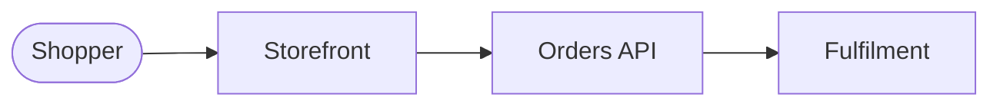
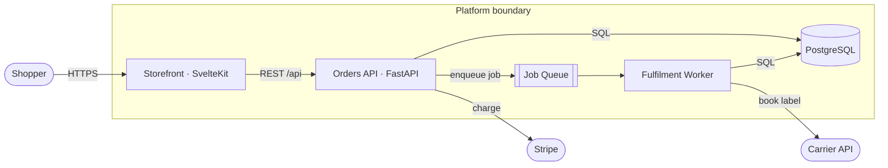
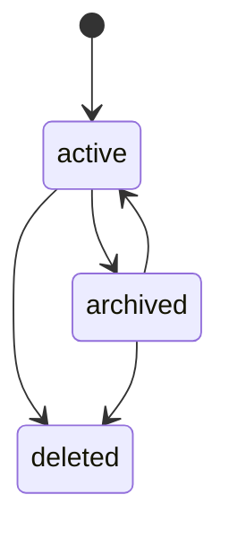

# Document architecture

Maintain one living, committed `product/ARCHITECTURE.md` — the always-current picture of the system.
It opens with a 3-second **Overview**, then is **mainly Mermaid diagrams**, then a
**Key Decisions** log that holds the durable, cross-version "why".

This is the durable counterpart to a plan's §02 architecture diagram. The plan visualizes one
version's _change_; `ARCHITECTURE.md` shows the _whole current system_ and the decision trail behind
it. It absorbs what used to be standalone ADRs — there is no separate `docs/adr/` tree. When a
plan is built, its lasting Design decisions are copied here as Key Decisions entries, so a reader
gets the reasoning without opening every plan in `product/plans/`.

## Rules

- **Mermaid, never ASCII art.** Diagrams must render and stay diffable.
- **Show what exists, not what's aspirational.** If it isn't built, it isn't in the diagram.
- **The minimum text a newcomer needs, never a wall of text.** Each diagram opens with a short
  walkthrough: one or two sentences on how to read it, then up to three bullets on what to notice
  (the surprising branch, the lock, the two-request round trip). It never restates the diagram,
  its table, or Key Decisions.
- **Split a diagram when it stops reading cleanly**, not only when it stops fitting one screen:
  edges crossing or back-tracking, or more than about a dozen edges. Split by stage or subsystem,
  one numbered subsection each, and never shrink the labels to buy room.
- **Number every section and open with a Contents list.** `01.`, `02.` on each `##`, `03.01` on
  each `###`, and a linked `## Contents` after the title, per `references/architecture-schema.md`.
- **Render every Mermaid block and look at the images before finishing**, for example with
  `npx -p @mermaid-js/mermaid-cli mmdc -i ARCHITECTURE.md -o out.md`. Crossing edges survive a
  read of the source and show only in the picture. When no renderer can run, say so in the
  report.
- **Update on shape change, not on every commit.** A diagram is stale only when the system no
  longer matches it; then the diagram and any new decision land in that same change.

## The 3-second read

`ARCHITECTURE.md` opens, after its Contents list, with an `## 01. Overview` section a newcomer
absorbs in seconds, before any diagram. It answers "what is this thing?" and nothing else. Two
parts:

1. **A short bullet list**, one bullet per idea: what the system does and for whom (an end user,
   an operator, or the developer importing it), then one bullet per stage of the system.
   Problem-domain words only.
2. **One line of shape** — the whole system as a single left-to-right flow, 3–6 nodes.

````markdown
## 01. Overview

- Shoppers browse a catalogue and place orders, and staff fulfil them from an admin console.
- The storefront takes the order and the Orders API records it.
- Fulfilment books a carrier and ships it.


````

- **A few seconds is the acceptance test.** A few bullets, one flow line, no scrolling. If the
  reader has to parse a branch, a legend, or a dense paragraph, it failed — cut until it passes.
- **Domain nouns, not codebase nouns.** `Orders`, `Fulfilment` — never `OrderAggregateService`,
  and never a framework or database name; those belong in the Components diagram.
- **Linear, never branching.** The overview is the spine. Externals, alternate paths, and every
  other actor go in the System context and Components diagrams — that is what they are for.
- **Rewrite it only when the system's purpose changes.** The spine survives most refactors; if it
  churns commit to commit, it is carrying detail that belongs in a real diagram.
- **An existing doc without one gets one first.** When updating an `ARCHITECTURE.md` that predates
  this section, write the Overview before any other edit — it is the cheapest part to produce and
  the part most readers never get past.

## The standard diagram set

Include the diagrams that apply; omit ones the system doesn't have. Order them outside-in.
**System context earns a separate diagram only when the externals are too many to sit legibly on
Components.** Otherwise draw them on Components, outside the boundary, as the example below does.

| Diagram        | Mermaid type      | Shows                                                                                                           |
| -------------- | ----------------- | --------------------------------------------------------------------------------------------------------------- |
| System context | `flowchart`       | External actors and systems around the boundary — who/what talks to it                                          |
| Components     | `flowchart`       | **The expanded Overview** — every internal piece and what crosses each connection (rules below)                 |
| Key flows      | `sequenceDiagram` | 1–3 critical request/lifecycle paths end to end                                                                 |
| Data model     | `erDiagram`       | Core entities and relationships (mirrors the `ceh-python-service:write-postgresql-code` entities)               |
| State machines | `stateDiagram-v2` | Legal status transitions for key entities (mirrors the `ceh-python-service:write-postgresql-code` status rules) |

**Components is the Overview with the detail put back** — same system, no longer a line. The
Overview is a spine _by rule_; Components branches, fans out, and loops back wherever the real
system does. There is no separate "expanded overview" diagram; when you want more than the spine,
you want this one:

- **Branch freely — that is the point.** The Overview's one-line constraint does not carry over.
  Fan-out, loop-backs, and every external the spine had to drop belong here.
- **Label every edge** with what crosses it — protocol, payload, or verb. A bare arrow says two
  things touch, not how; that is the difference between a picture and a diagram.
- **Draw the trust or deployment boundary as a `subgraph`.** Anything outside it is someone else's
  system: you cannot change it, and it fails independently.
- **Name the technology on the node** (`Orders API · FastAPI`). This is the diagram where stack
  names belong.
- **Cut edges that only repeat.** Many calls into one node can name the endpoint inside each
  calling node instead of drawing every arrow to it. Externals of one kind (inputs, services
  fetched over the network) sit in one `subgraph` with one edge to the group.
- **Split by stage when it stops reading cleanly**, per the Rules. A node two parts share (the
  database, the server) is the join point: it appears in both, and the walkthrough says so.
- **Skip it if it adds nothing.** If Components would be the Overview plus a node or two, the system
  is small enough that the Overview _is_ the whole picture — ship it alone and move on.



State-machine diagrams must match the `ceh-python-service:write-postgresql-code` rule that not all
transitions are legal — draw only the legal edges:



## Key Decisions

The durable record of significant architectural decisions — ones that would confuse a future
developer without context, or that reversing would require a migration or refactor. This is the
single home for decision rationale; record one whenever you choose a framework/runtime/persistence
strategy, pick between fundamentally different patterns, plan a major dependency upgrade, or reverse
a prior decision in a new version.

Append entries to the numbered Key Decisions section at the bottom of `ARCHITECTURE.md`, newest last, in
the entry shape of `assets/architecture.template.md`, per `references/architecture-schema.md`.

- **Never delete a decision.** To change one, append a new entry and mark the old one
  `Superseded by <date title>`. The trail is the cross-version narrative.
- **Never silently diverge** from an accepted decision — supersede it on the record first.
- Keep entries short. The diagrams carry the structure; these carry the reasoning.

## Storage

`product/ARCHITECTURE.md` in the target repo, committed, unless the repo's `CLAUDE.md` names another
path. A new file starts as a copy of `assets/architecture.template.md`, and an existing one
without its `schema:` line, or on an older version, is brought up to the template on the next update. Later planning reads it and a fresh clone must keep the decision trail, so it never lives in
a git-ignored folder. `product/` holds the files the people and agents building the product read,
and `docs/` is left to users of the product. When a `.agents_workspace/ARCHITECTURE.md` from an
earlier version exists and `product/ARCHITECTURE.md` does not, move it there first and say so. For
a large system, the diagram set may move to `product/architecture/` with one file per view, but the
Overview and Key Decisions sections stay in `ARCHITECTURE.md` itself — the spine and the
decision trail must remain readable and greppable in one place.
