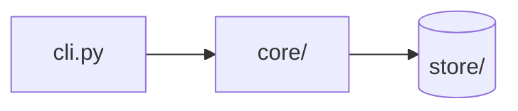

# Codebase Explained — <repo-name>

## What this repo is

<2–4 sentences: what it does, who it is for, what kind of project it is, what stack it runs on. For
a knowledge base: what subjects it covers, who it is written for, and how it is organized.>

## How it fits together

<One paragraph naming the moving parts and the direction things flow.>

## Components

### `src/api/` — HTTP surface

**What it is.** Route handlers; no business logic.
**What's inside.** `auth.py` issues the JWT every other route verifies; `deps.py` holds the FastAPI
dependencies (DB session, current user). The remaining 9 modules are one resource each, all built on
the same `deps.py` pair.
**How it connects.** Registered by `main.py` on startup; calls `services/`. Owns no state.
**Before you change it.** Route paths are duplicated in `tests/conftest.py`.

## Key flows

### Authenticated request

1. `main.py` → routes registered at startup
2. `api/deps.py` verifies the token
3. `services/user.py` loads the record
4. `store/pg.py` runs the query

## Repo meta

<The support cast as group rules — CI workflows, packaging config, editor and lint config, license.>

## Gaps and oddities

<Factual observations only: dead code, missing CI, a component whose purpose could not be
determined and what was checked.>

## Accounting

|                                                      | Count |
| ---------------------------------------------------- | ----- |
| Files in inventory                                   | N     |
| Assigned to a component                              | X     |
| Covered by a group rule                              | Y     |
| Excluded (`.agents_workspace/`, lockfiles, binaries) | Z     |
