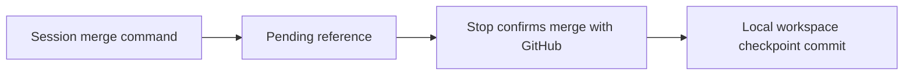

<!-- prettier-ignore-start -->

# Architecture

## Contents

- [01. Overview](#01-overview)
- [02. Key Decisions](#02-key-decisions)

## 01. Overview

- CEH plugins guide agents through shaping, building, proving and telling people about products.
- Workspace sync hooks preserve session artifacts and link local checkpoints to merged source PRs.

## 02. Key Decisions

### 2026-11-13 — Workspace sync commits use Conventional Commits

**Status:** Accepted
**Context:** Scripted workspace commits used a ceh-ws type that the commit skill does not accept.
**Decision:** Use chore(workspace): sync worktree <folder>, limited to 72 characters. Preserve the
ceh-ws branch prefix and existing history.
**Consequences:** Future scripted sync commits follow the same subject rules as session commits.

### 2026-11-13 — Source PR checkpoints extend the existing workspace sync hook

**Status:** Accepted
**Context:** Workspace artifacts need a history link to the source PR that a session merges.
**Decision:** Record the merge reference before gh pr merge, then confirm it at Stop and commit all
workspace changes locally with the PR URL and merge commit in the body. Allow an empty
checkpoint, retain open or failed lookups, and expire pending entries after 14 days.
Claims belong to the originating checkout and cannot overwrite newer pending entries
when restored. Use a fixed-length digest for branch filenames and consult existing
checkpoint commit bodies to discard replayed merge events. Detect command boundaries
outside shell quotes and escapes. Do not push from this hook.
**Consequences:** A queued auto-merge is checkpointed at a later Stop. Browser-only merges are not recorded.
The installed-hook check against a real merged PR remains pending.

### 2026-11-13 — Usage-limit warnings require evidence of setup

**Status:** Accepted
**Context:** Installing ceh-every-session does not configure a statusline quota export. An inactive
warning on every unconfigured session distracts users who never requested the guard.
**Decision:** With no quota reading, warn once per session only when CEH_USAGE_LIMIT_THRESHOLD or
CEH_USAGE_STALE_MINUTES is present in the environment, or ~/.claude/statusline/ exists.
Otherwise return silently. Setting a variable to its default or an empty value still
counts as setup. Keep stale-reading warnings and the existing threshold behavior.
**Consequences:** An unconfigured installation stays quiet. A configured guard with a missing or broken
export still reports that protection is inactive. No export script or new variable ships.

### 2026-11-13 — Document the skill listing budget without changing user settings

**Status:** Accepted
**Context:** Skill descriptions can disappear when the listing exceeds its context budget, leaving
fewer keywords for Claude to match requests. Machine setup has its own draft plan.
**Decision:** Keep an unnumbered troubleshooting section after the five install steps. Explain the
default 1% budget, /doctor and /skill-doctor, skillListingBudgetFraction at 0.02 for 2%,
and name-only skillOverrides as another way to free budget. Link the official skills docs.
**Consequences:** Readers can diagnose missing descriptions and choose their setting. The install route
does not edit user settings or promise an unshipped setup script.

### 2026-11-13 — Keep branch cleanup rules consistent with pull-request

**Status:** Accepted
**Context:** The user's branch cleanup rule requested deletion on origin even when GitHub already
deleted the head branch, while pull-request leaves remote cleanup to the repository setting.
**Decision:** Keep pull-request unchanged. The user's rule deletes the local branch and leftover
worktree, and deletes the branch on origin only where GitHub did not already delete it.
Record the amendment beside the original answer in the user's separate rule repository.
**Consequences:** GitHub's Automatically delete head branches setting remains the primary remote cleanup
mechanism. The amendment records intent for later readers and the weekly lessons job,
whose handling of that note has not been checked.

### 2026-11-14 — One product folder in the workspace

**Status:** Accepted
**Context:** A target project had two product folders, root product/ for committed handoff files and
.agents_workspace/product/ for local output, and artifacts in one cited artifacts in the
other. Vision principle 2 was amended first to accept the versioned workspace.
**Decision:** Every plugin skill, hook and script saves and reads product artifacts in
.agents_workspace/product/ only, unless the repo's CLAUDE.md names another location. A file
found only at the old root product/ is reported with its move, never read or written
beside. No skill assumes the workspace is a git repo, and no reading of the old path is
kept as a fallback.
**Consequences:** A project with a root product/ moves its files or names its location in CLAUDE.md. A linked
worktree gets a workspace only when the workspace is a git repo, and a subagent started
with isolation worktree gets none, so its caller passes it the artifact. This repo keeps
its own product/ until a plan moves it.

### 2026-11-14 — References name the YAML, checked by artifact-paths

**Status:** Accepted
**Context:** Skills, schemas, templates and READMEs named the generated .md of formats whose source is
YAML, and nothing stopped a root product/ path from coming back.
**Decision:** A path to a format with a YAML source ends in .yaml. The artifact-paths check in validate.py
fails on a root product/ path or such a .md path under plugins/standalone/, outside an
allowlist of legacy plan/v1 plans, old-path notes and generated Markdown a script reads,
one reason per entry.
**Consequences:** Markdown-only formats stay Markdown until each gets its own YAML plan, which removes its
allowlist entry. A new exception needs an allowlist entry with its reason.

### 2026-11-14 — Fix records link to their fix by a commit footer

**Status:** Accepted
**Context:** A fix record in the workspace cannot ride in the source repo's fix commit, which was how
git log found the fix.
**Decision:** The fix's commit message carries the footer Refs: fixes/<slug>, so git log --grep finds it.
fix-record/v2 keeps every key, and its PlanPath and FixPath accept both the workspace path
and the old root form, so a record saved earlier still checks.
**Consequences:** The link lives in the commit message, so a fix committed without the footer has no link
back to its record.

### 2026-11-14 — One retro file, and a worktree sync commit before a new worktree

**Status:** Accepted
**Context:** The in-repo and local retro files would share one name in one folder, and a worktree's
workspace holds only committed files, so a plan left uncommitted in the main workspace was
missing there.
**Decision:** review-recent-work, diagnose-session and prevent-repeat-mistake each save one file holding
every issue, as period-retro/v2 and session-retro/v2, and repeat-mistake/v2 with other_file
always null. sync-agents-workspace.py commits the main workspace before adding a worktree,
except during the user's own merge, and merges the main branch into a ceh-ws/ branch that
already existed.
**Consequences:** Older retro pairs are still read. A worktree start commits pending workspace files the user
may have meant to leave uncommitted.

<!-- prettier-ignore-end -->
