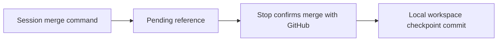

<!-- prettier-ignore-start -->

# Architecture

## Contents

- [01. Overview](#01-overview)
- [02. Key Decisions](#02-key-decisions)

## 01. Overview

- CEH plugins guide agents through shaping, building, proving and telling people about products.
- Workspace sync hooks preserve session artifacts and link local checkpoints to merged source PRs.

## 02. Key Decisions

### 2026-11-13 — Workspace sync commits use Conventional Commits

**Status:** Accepted
**Context:** Scripted workspace commits used a ceh-ws type that the commit skill does not accept.
**Decision:** Use chore(workspace): sync worktree <folder>, limited to 72 characters. Preserve the
ceh-ws branch prefix and existing history.
**Consequences:** Future scripted sync commits follow the same subject rules as session commits.

### 2026-11-13 — Source PR checkpoints extend the existing workspace sync hook

**Status:** Accepted
**Context:** Workspace artifacts need a history link to the source PR that a session merges.
**Decision:** Record the merge reference before gh pr merge, then confirm it at Stop and commit all
workspace changes locally with the PR URL and merge commit in the body. Allow an empty
checkpoint, retain open or failed lookups, and expire pending entries after 14 days.
Claims belong to the originating checkout and cannot overwrite newer pending entries
when restored. Use a fixed-length digest for branch filenames and consult existing
checkpoint commit bodies to discard replayed merge events. Detect command boundaries
outside shell quotes and escapes. Do not push from this hook.
**Consequences:** A queued auto-merge is checkpointed at a later Stop. Browser-only merges are not recorded.
The installed-hook check against a real merged PR remains pending.

<!-- prettier-ignore-end -->
