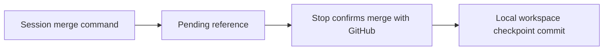

<!-- prettier-ignore-start -->

# Architecture

## Contents

- [01. Overview](#01-overview)
- [02. Key Decisions](#02-key-decisions)

## 01. Overview

- CEH plugins guide agents through shaping, building, proving and telling people about products.
- Workspace sync hooks preserve session artifacts and link local checkpoints to merged source PRs.

## 02. Key Decisions

### 2026-11-13 — Workspace sync commits use Conventional Commits

**Status:** Accepted
**Context:** Scripted workspace commits used a ceh-ws type that the commit skill does not accept.
**Decision:** Use chore(workspace): sync worktree <folder>, limited to 72 characters. Preserve the
ceh-ws branch prefix and existing history.
**Consequences:** Future scripted sync commits follow the same subject rules as session commits.

### 2026-11-13 — Source PR checkpoints extend the existing workspace sync hook

**Status:** Accepted
**Context:** Workspace artifacts need a history link to the source PR that a session merges.
**Decision:** Record the merge reference before gh pr merge, then confirm it at Stop and commit all
workspace changes locally with the PR URL and merge commit in the body. Allow an empty
checkpoint, retain open or failed lookups, and expire pending entries after 14 days.
Claims belong to the originating checkout and cannot overwrite newer pending entries
when restored. Use a fixed-length digest for branch filenames and consult existing
checkpoint commit bodies to discard replayed merge events. Detect command boundaries
outside shell quotes and escapes. Do not push from this hook.
**Consequences:** A queued auto-merge is checkpointed at a later Stop. Browser-only merges are not recorded.
The installed-hook check against a real merged PR remains pending.

### 2026-11-13 — Usage-limit warnings require evidence of setup

**Status:** Accepted
**Context:** Installing ceh-every-session does not configure a statusline quota export. An inactive
warning on every unconfigured session distracts users who never requested the guard.
**Decision:** With no quota reading, warn once per session only when CEH_USAGE_LIMIT_THRESHOLD or
CEH_USAGE_STALE_MINUTES is present in the environment, or ~/.claude/statusline/ exists.
Otherwise return silently. Setting a variable to its default or an empty value still
counts as setup. Keep stale-reading warnings and the existing threshold behavior.
**Consequences:** An unconfigured installation stays quiet. A configured guard with a missing or broken
export still reports that protection is inactive. No export script or new variable ships.

### 2026-11-13 — Document the skill listing budget without changing user settings

**Status:** Accepted
**Context:** Skill descriptions can disappear when the listing exceeds its context budget, leaving
fewer keywords for Claude to match requests. Machine setup has its own draft plan.
**Decision:** Keep an unnumbered troubleshooting section after the five install steps. Explain the
default 1% budget, /doctor and /skill-doctor, skillListingBudgetFraction at 0.02 for 2%,
and name-only skillOverrides as another way to free budget. Link the official skills docs.
**Consequences:** Readers can diagnose missing descriptions and choose their setting. The install route
does not edit user settings or promise an unshipped setup script.

### 2026-11-13 — Keep branch cleanup rules consistent with pull-request

**Status:** Accepted
**Context:** The user's branch cleanup rule requested deletion on origin even when GitHub already
deleted the head branch, while pull-request leaves remote cleanup to the repository setting.
**Decision:** Keep pull-request unchanged. The user's rule deletes the local branch and leftover
worktree, and deletes the branch on origin only where GitHub did not already delete it.
Record the amendment beside the original answer in the user's separate rule repository.
**Consequences:** GitHub's Automatically delete head branches setting remains the primary remote cleanup
mechanism. The amendment records intent for later readers and the weekly lessons job,
whose handling of that note has not been checked.

<!-- prettier-ignore-end -->
