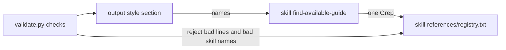

## Goal

When the work first names a framework, library, or service, the agent looks it up in a plain-text
registry of skills, plugins, and MCP servers worth installing. On a hit it finishes the task, then
tells the user what exists and how to install it. It installs nothing and says nothing on a miss.
The idea and its vision check are the "Capability lookup" row in `docs/IDEAS.md`.

It lives in `ceh-every-session` because that plugin's forced output style is the one always-loaded
channel a plugin has, and the lookup serves any session that names a tool, not only coding ones.
The registry still lists only help for shipping or telling about a product (vision scope test).

## Scope

**In:**

- A registry with one verified entry, the Pydantic plugin, one line per install method, kept in the lookup skill's `references/`, and a `registry.schema.md` beside it that describes each column. The GitHub MCP server was seeded first and removed on 2026-10-16 as not needed.
- A `validate.py` check that rejects a malformed registry line.
- A model-only skill, `ceh-every-session:find-available-guide`, that greps the registry for the names the work mentions and writes the suggestion note.
- One short section in the `CEH Every Session` output style that starts the skill when the work first names a framework, library, or service, and a `validate.py` check that the skill name in the style resolves.
- The registrations CI expects, listed in Phase 4.

**Out:**

- A `UserPromptSubmit` hook. It is step 5 of the IDEAS entry and waits on a measured miss (vision principle 7).
- The micro-test of the trigger. It makes billed model calls, so it waits for a request.
- Running an install. The agent shows the command and the user decides.
- More entries than the two. Each new entry needs a real case and a check against its source.
- Entries outside building, proving, or telling people about a product (Outlook, Notion).
- Session-start or tool-call detection of names. The model takes names from the prompt.
- State that survives compaction or a new session. A repeat lookup or suggestion is accepted.
- Changes to `whats-next`, which suggests among installed skills.
- Putting the names in the output style line. See the first decision below.

## Design

- **Delivery goes through the skill, not a path in the output style.** The Claude Code output styles page says nothing about `${CLAUDE_PLUGIN_ROOT}` inside a style, while skill bodies do substitute `${CLAUDE_SKILL_DIR}`. So the style names the skill, and the skill holds the Grep.
- **Independent of Claude Code's own suggestions.** The `relevance` suggestions need an administrator to allowlist a marketplace in managed settings, so they do not reach an individual user, an MCP server, or a standalone skill. This lookup needs no administrator, reads no marketplace setting, and covers every install method in the registry.
- **Names stay out of the style line, on purpose.** Putting every name and alias in the always-loaded line would make a miss cost nothing, but it recreates the list that stops scaling past a few dozen entries, which is the problem this design exists to avoid. The cost taken instead: one Skill call plus one Grep per batch of new names, hit or miss, and the skill text stays in context afterwards. The style tells the agent to invoke the skill once, and to re-run the skill's Grep for later new names without invoking it again. If the micro-test later shows the call cost matters, this is the first thing to revisit.
- **Two triggers, one skill.** The style section is the always-loaded nudge. The skill description names the same moment, "the work first names a framework, library, or service in this conversation", so either can start it. Skill descriptions alone fired about half the time in the one study found, so the style carries the weight.
- **The registry is the gate for "non-trivial".** The model does not judge triviality. It extracts every name not yet looked up in this conversation. "Not yet looked up" is read from the conversation, with no state file.
- **Registry format**, in `plugins/standalone/ceh-every-session/skills/find-available-guide/references/registry.txt`, cited from the skill as `${CLAUDE_SKILL_DIR}/references/registry.txt`: one line per entry and install method, `name | aliases | kind | beats | method | install | source | checked`. An entry with several ways to install has several lines, the preferred method first. Lines starting with `#` are comments, and blank lines are ignored. `aliases` is comma-separated. `kind` is what the entry is: `skill`, `plugin`, or `mcp`. `method` is how it installs: `plugin` (a Claude Code plugin marketplace), `mcp-add` (a `claude mcp add` or `add-json` command), or `skill-copy` (copy the skill directory into `.claude/skills/` or `~/.claude/skills/`). The two are separate because a skill or an MCP server can reach the user by more than one method, and only `plugin` goes through a marketplace. `beats` is what the agent does without the entry, which is also the reason the entry is listed (vision principle 8). `install` is the exact command, copied from the source on the `checked` date, with several commands joined by `&&`. `source` starts with `https://`. `checked` is a real `YYYY-MM-DD` date that is not in the future. A name and install pair is unique ignoring case. No cell contains `|`.
- **The Grep pattern** is limited to the name and alias cells, so a name in a URL or install cell does not match. With the names regex-escaped and joined by `|`, it is `^(?:[^|]*\|)?[^|]*\b(?:NAME1|NAME2)\b`, case-insensitive, output as content lines. A Grep that is denied or fails counts as a miss: the agent says nothing and continues.
- **Dropping hits already installed.** A hit is dropped when its name or an alias appears as a `<plugin>:` prefix in the skill listing, or inside a tool name such as `mcp__github__...` in the tool list. The model can see both lists, so no `claude mcp list` call is needed.
- **Where the note goes.** Finish the task first. Then one plain line per hit goes below the reply's `---` line and above any Decision block, because it belongs to no Topic. Each line has the name, its kind, what it beats, the install command, a recommended scope, and `/reload-plugins` or a restart afterwards. The note is the registry's own text, not paraphrased.
- **Scope advice differs by method.** `plugin`: `--scope project`, as `whats-next` recommends. `mcp-add`: `--scope user` or `local` when the command carries a token, never `project`, because the token would land in the committed `.mcp.json`. `skill-copy`: `.claude/skills/` for the project or `~/.claude/skills/` for the user. The scope sits in the note, and the `install` cell stays the bare command. When an entry has several lines, the note shows the first and names the others in one clause.
- **Entries are our own pointers, not copied text.** Output style and skill text carry the weight of a user instruction, so a third-party README must never flow into a cell.
- **The skill is model-only**: `disable-model-invocation: false`, `user-invocable: false`, because the user would never type its name. It sets `allowed-tools: Grep` so reading a registry under the plugin cache does not raise a permission prompt on every hit. This is assumed to work and is not yet confirmed (Phase 1 asks, Open records it).
- **validate.py edits.** One registry check as above. The skill-reference scan also reads `output-styles/*.md`, so the skill name in the style is checked. `.txt` joins `HYGIENE_SUFFIXES` so the registry gets the invisible-character and personal-path checks. `MAX_TOTAL_DESCRIPTION_LEN` rises by the new description's length and nothing more, as its comment requires.
- **Seed entries**, each read at its source on 2026-10-16. GitHub MCP server, kind `mcp`, aliases `github` and `pull request`, two lines: method `mcp-add` with `claude mcp add-json github '{"type":"http","url":"https://api.githubcopilot.com/mcp","headers":{"Authorization":"Bearer YOUR_GITHUB_PAT"}}'` from its Claude installation guide, then method `mcp-add` with the local Docker command `claude mcp add github -e GITHUB_PERSONAL_ACCESS_TOKEN=$GITHUB_PAT -- docker run -i --rm -e GITHUB_PERSONAL_ACCESS_TOKEN ghcr.io/github/github-mcp-server` from its README. Pydantic, kind `plugin`, method `plugin`, `claude plugin marketplace add pydantic/skills && claude plugin install pydantic@pydantic-skills` from its README. No `skill-copy` entry is seeded, because no source read so far documents one. The method exists in the format so the first such entry needs no format change.
- **Version.** `ceh-every-session` 2.7.12 to 2.8.0, since it gains a skill.

## Phases

### Phase 1: Confirm Claude Code does not already do this

- **Builds:** nothing. It answers two questions: does Claude Code natively suggest plugins or MCP servers while the user works, and does a Grep or Read of a file under the plugin cache raise a permission prompt, with or without `allowed-tools` on the skill. The first would make the plan redundant under the vision's non-goal on rebuilding Claude Code. The second decides whether the skill's design is usable.
- **Check:** ask the `claude-code-guide` agent both questions and read its answers. It passes when each answer cites the docs, no native suggestion feature is described, and the prompt answer is either "no prompt" or names the setting that avoids it. A web search on 2026-10-16 found no native feature, and no command can prove an absence, so this is a manual check. If a native feature exists, stop, set this plan to `draft`, and report. If the answer on the prompt is unclear, record it under Open and continue.
- **Status:** done on 2026-10-16, by the user's decision after a stop at the first pass criterion. The `claude-code-guide` agent found native suggestions, though narrow. The `relevance` feature (docs `plugins/relevance.md`, `plugins/org.md`) suggests plugins from session signals such as cwd, commands run, files read, and manifest dependencies, not from names in the conversation. It shows nothing until an administrator lists a marketplace in managed-settings `pluginSuggestionMarketplaces`, covers plugins only, and never installs. The LSP plugin recommendation dialog (`plugins/code-intelligence.md`) offers a code-intelligence plugin once per session when its language server is on PATH. The docs do not say MCP servers or standalone skills are suggested. On the prompt question, the permissions docs imply a prompt for a Grep outside the working directory in default mode, say a skill's `allowed-tools` grant lasts for the turn that invokes it, and do not confirm that the bare name `Grep` works or that plugin directories are exempt. The user ruled that the lookup must not depend on the native feature, which needs an administrator (a managed instance), and that the registry must record the install method. The prompt question stays under Open.

### Phase 2: Registry, validator check, and the lookup skill

- **Builds:** the registry with the two seed entries, `skills/find-available-guide/SKILL.md` from `SKILL.template.md` (procedure, Grep pattern, installed-drop rule, note placement, scope advice, and the never-install rule from Design, with a `>-` description of at most 300 characters), the `validate.py` registry check, the `.txt` hygiene suffix, the raised `MAX_TOTAL_DESCRIPTION_LEN`, and the plugin README row that names `` `find-available-guide` `` (the hygiene check needs it as soon as the skill exists).
- **Check:** `python tools/validate-plugins/validate.py` passes and `claude plugin validate plugins/standalone/ceh-every-session` passes. Then, one at a time and restoring each time, seven edits to a registry line must each make `validate.py` fail naming that line: delete a field, set `kind` to `tool`, set `method` to `ssh`, change `https://` to `http://`, set `checked` to `2099-01-01`, duplicate a name and install pair in another case, and put a `|` in a cell. Then run the skill's pattern with `rg -i` against the registry for `github` (one hit), `requests` (no hit), and `https` (no hit, since it appears only in other cells).
- **Status:** done on 2026-10-16. `python tools/validate-plugins/validate.py` printed `OK: all plugin checks passed` after the last edit, and `claude plugin validate plugins/standalone/ceh-every-session` printed `Validation passed`. Each of the seven registry edits failed the validator naming `registry.txt:<line>`, and the restored file passed. `grep -P -i` with the skill's pattern (`rg` is not installed here, and the regex is the same) returned 2 lines for `github`, 1 for `pydantic`, 0 for `requests`, and 0 for `https`. The description is 284 characters and `MAX_TOTAL_DESCRIPTION_LEN` rose by exactly that, from 27045 to 27329.

### Phase 3: The output style section

- **Builds:** one short section in `output-styles/ceh-every-session.md` telling the agent to invoke `ceh-every-session:find-available-guide` once with every framework, library, or service name not yet looked up in this conversation, before starting, to re-run the skill's Grep for later new names, and to say nothing when nothing is listed. It also adds `output-styles/*.md` to the skill-reference scan in `validate.py`.
- **Check:** `python tools/validate-plugins/validate.py` passes. Then change the skill name in the section to a name that does not exist, see `validate.py` fail naming the style file, and restore it.
- **Status:** done on 2026-10-16. With the section naming `find-available-guides` (a typo) and no output-style scan, `validate.py` passed, which showed the gap. After adding `output_style_files()` to the skill-reference scan it printed `FAIL: ... skill reference 'ceh-every-session:find-available-guides' does not resolve`, naming the style file. With the name fixed it printed `OK: all plugin checks passed`, and `claude plugin validate` printed `Validation passed`.

### Phase 4: Registrations

- **Builds:** a `docs/CATALOG.md` Skills row with the Invoke cell `Model-only, no slash command`. In `plugins/standalone/ceh-every-session/README.md`: the Manual triggers line for the skill, a mention in the output style row, and a short Registry section on the entry format and the rule that entries are our own pointers. The Checks table and docstring in `tools/validate-plugins/README.md` and `validate.py` for the new checks. The mentions in the root `README.md` and `docs/GETTING_STARTED.md` rows for `ceh-every-session`, only where those rows enumerate its skills. A MINOR bump to 2.8.0 in `plugin.json` and `.claude-plugin/marketplace.json`. The `docs/PLUGIN_VERSIONS.md` row with version 2.8.0 and date 2026-10-16. A row in the Plugin versions table of the existing `## 2026-10-16` section of `CHANGELOG.md`, with the entry text. In `docs/IDEAS.md`, the "Capability lookup" row stays open, its Note corrected to say the lookup costs a Skill call plus a Grep, and its Status updated to say steps 1 to 3 are built and steps 4 and 5 are open.
- **Check:** `python tools/validate-plugins/validate.py` passes, `pre-commit run --files <each touched file>` passes on a second run, and `git diff --stat` shows only files this plan names.
- **Status:** done on 2026-10-16. After the last edit, `python tools/validate-plugins/validate.py` printed `OK: all plugin checks passed`, `claude plugin validate plugins/standalone/ceh-every-session` printed `Validation passed`, and a second `pre-commit run --files` over all 13 touched files passed ruff and prettier. `git diff --stat` lists 10 modified files, each named in this plan, plus the new skill directory and this plan. The root `README.md` and `docs/GETTING_STARTED.md` rows were left alone: neither enumerates every `ceh-every-session` skill (`record-project-decisions` is already absent from both), and the root README row is its table's widest cell, so editing it would re-pad 28 rows.

## Open

- **A live run is not part of this plan.** Whether the agent actually fires the skill is unmeasured, and a real run is a billed model call. To see it once, run `claude --plugin-dir plugins/standalone/ceh-every-session -p "add a pydantic model for an order payload"` and look for the skill call and the closing note. Whether output styles apply under `claude -p` is also unconfirmed. The five-run comparison against a no-guidance control waits for a request. Assumed until then: the section and the description fire often enough to be worth measuring.
- **The permission prompt is unconfirmed.** Assumed: `allowed-tools: Grep` stops a prompt on the registry read. The permissions docs imply a prompt for a Grep outside the working directory in default mode, and say a skill's `allowed-tools` grant lasts for the turn that invokes it. If a prompt appears, the fallbacks are one user allow rule for the plugin cache path, or starting Claude Code with `--add-dir` on it (documented, not tested here). A `Read` fallback faces the same rule, so it is no fix.
- **No recorded failure yet.** The IDEAS row waits on one real case where the agent hand-rolled what a listed server or skill covers. The user chose to build now, so this plan proceeds, and the row keeps that wait visible.
- **Subagents skip the section.** Output styles reach only the main conversation and forks. Assumed acceptable, since the main session reports to the user.
- **Install commands age.** Each entry carries its `checked` date, and nothing re-checks it automatically. Assumed acceptable at two entries.

## Record

- 2026-10-16 Planned: status ready
- 2026-10-16 Reviewed: Revise first, 2 blocking (Phase 3 check failed on a missing README row and the description ratchet, Phase 4 check scanned no output styles)
- 2026-10-16 Built Phase 1: claude-code-guide answers read, native suggestions are administrator-gated, so the user ruled to continue
- 2026-10-16 Built Phase 2: `python tools/validate-plugins/validate.py`, OK: all plugin checks passed
- 2026-10-16 Built Phase 3: `python tools/validate-plugins/validate.py`, OK: all plugin checks passed
- 2026-10-16 Built Phase 4: `python tools/validate-plugins/validate.py`, OK: all plugin checks passed
- 2026-10-16 Changed: the user removed the two GitHub MCP lines from the registry as not needed, and `references/registry.schema.md` was added. The Design seed-entries bullet and the Phase 2 status still describe the GitHub lines as first built. The `mcp-add` and `skill-copy` methods stay in the format with no entry.
- 2026-10-16 Checked: 25 Built, 1 Deviation, 0 Gap, 0 Extra, 0 Failing, 5 Cannot verify. Deviation: Phase 1 pass criterion "no native suggestion feature is described" was not met, and the user ruled to continue. Cannot verify: the skill firing in a real session, the permission prompt, output styles under `claude -p`, `rg` against the `grep -P` run, and the install commands staying current. The three install commands were checked word for word against the raw README and installation guide on 2026-10-16.
- 2026-10-16 PR: #116 https://github.com/cheneeheng/ceh-claude-code-library/pull/116
